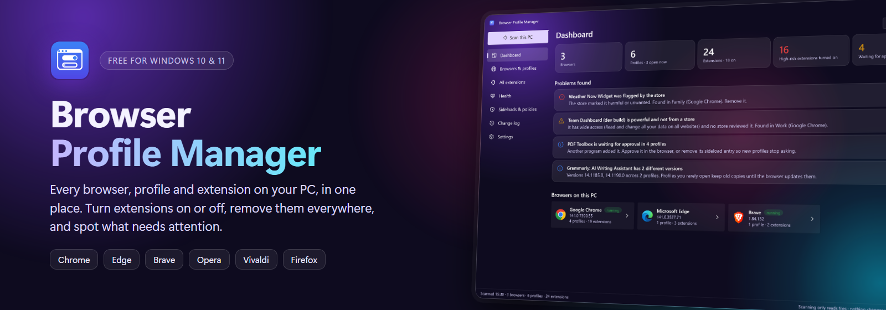
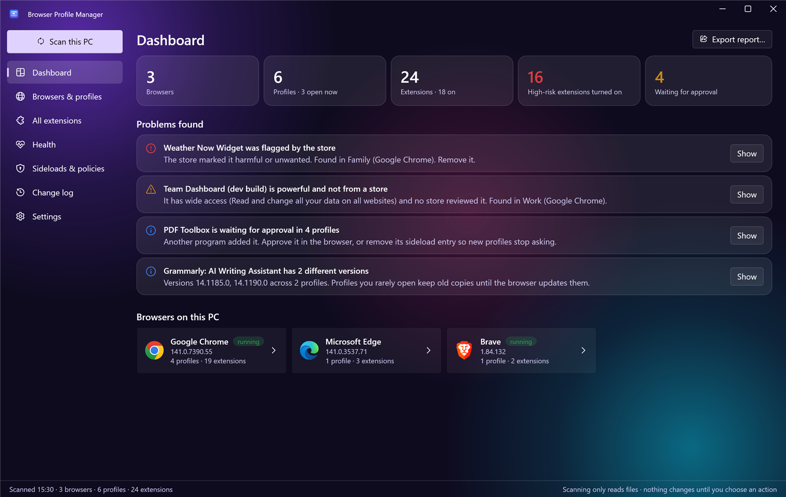
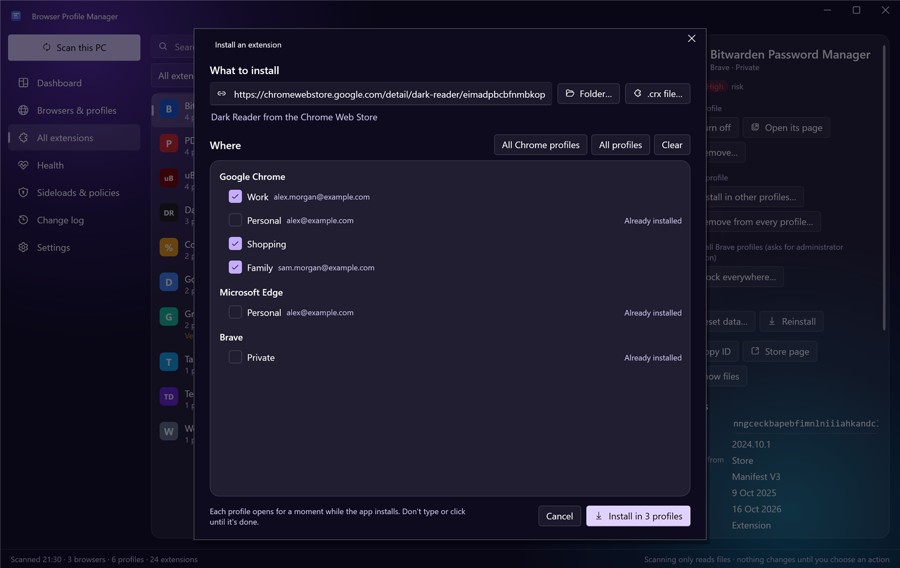
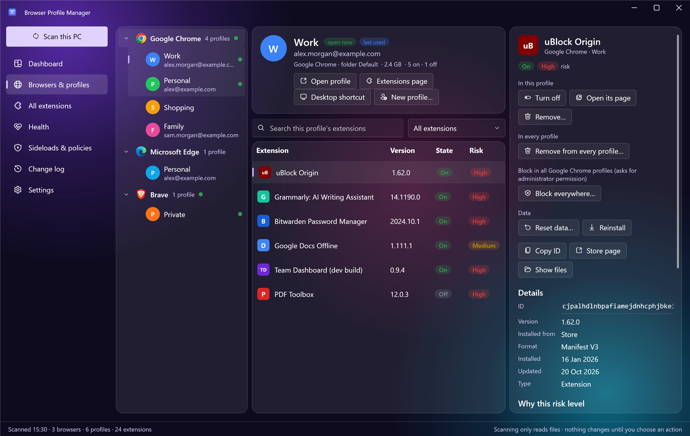
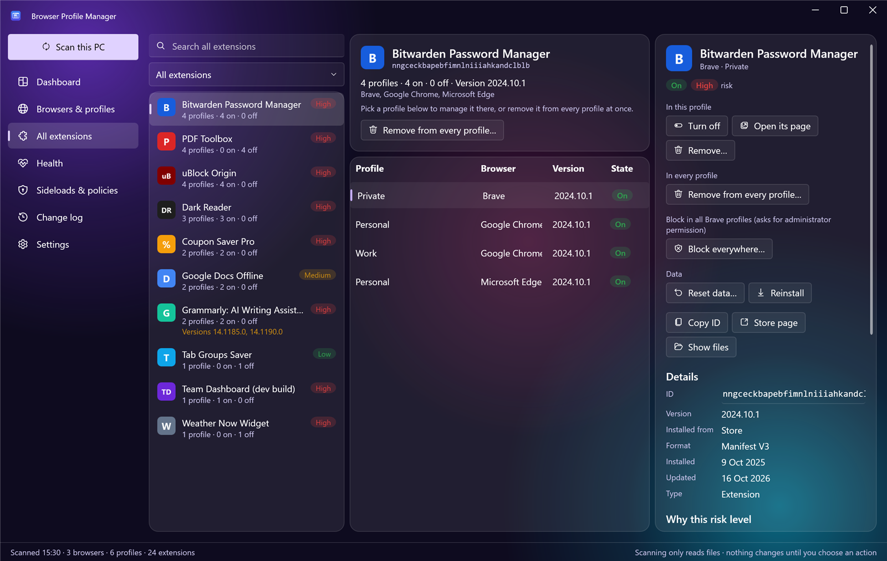
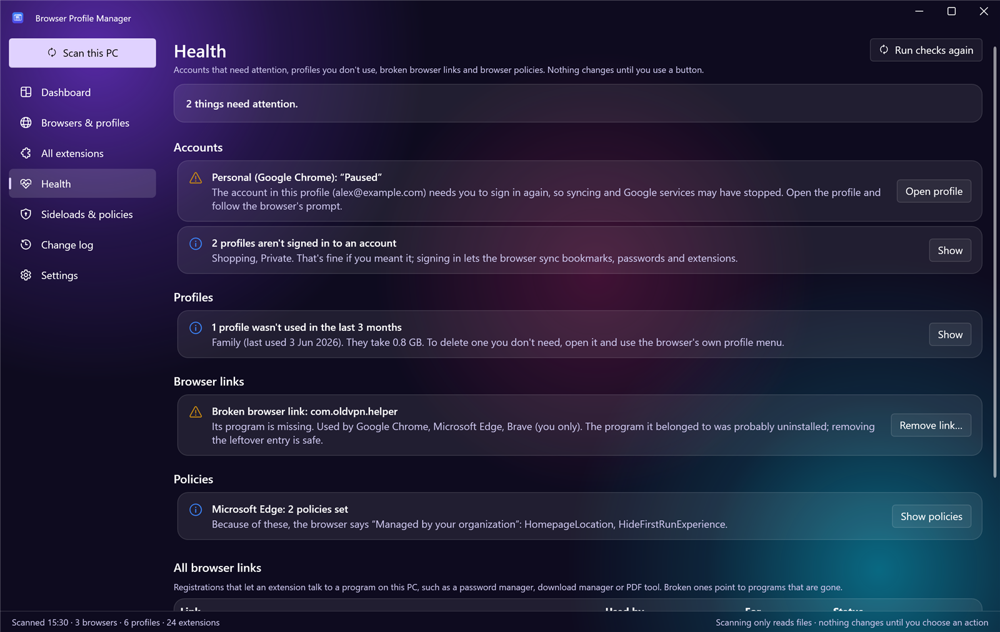
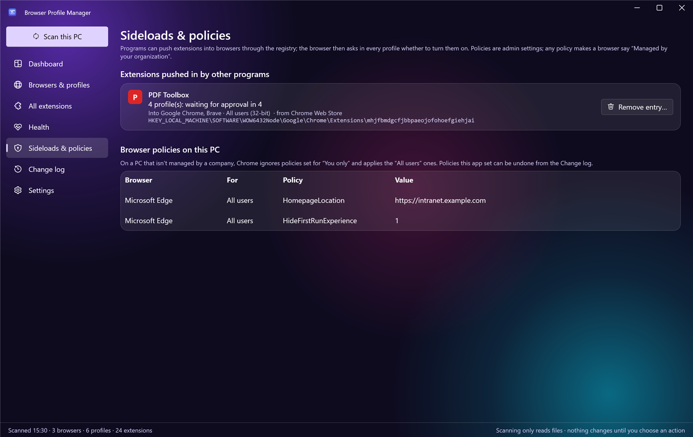
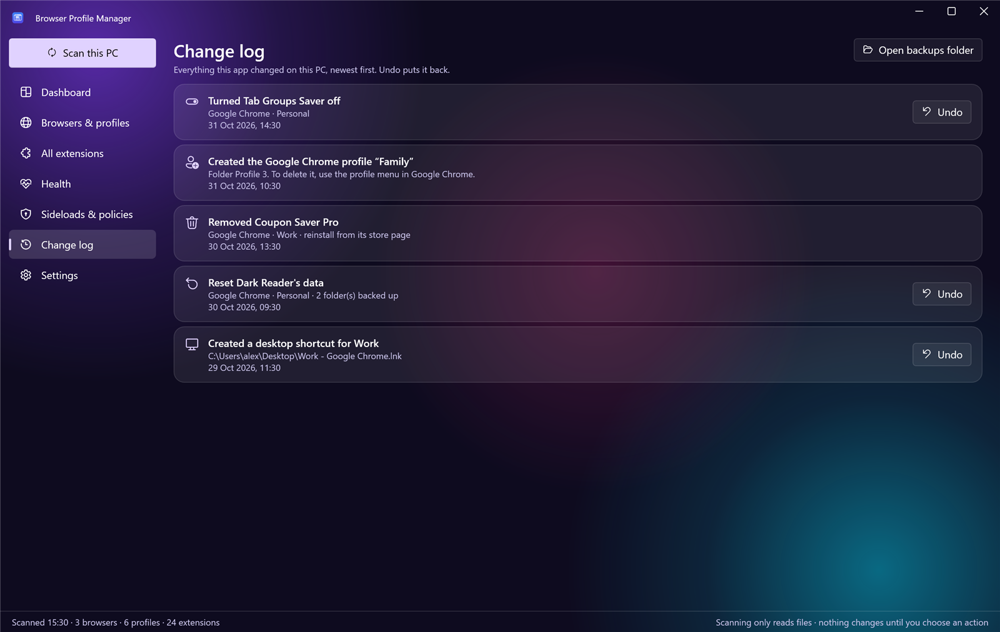
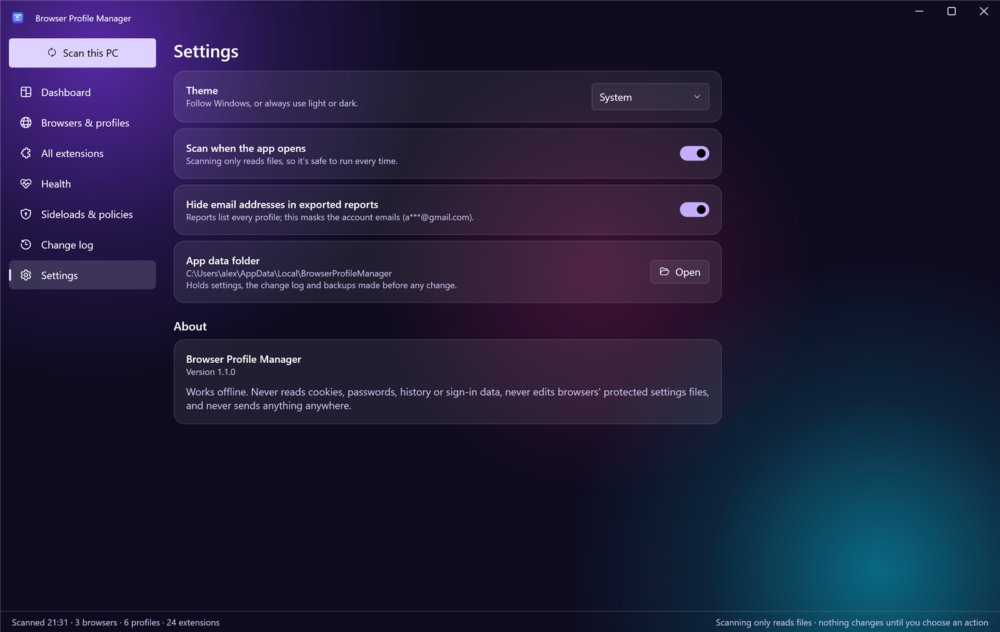

<p align="center">
  
</p>

<p align="center">
  <a href="https://github.com/kkeyqik/BrowserProfileManager/releases/latest"></a>
  <a href="https://github.com/kkeyqik/BrowserProfileManager/actions/workflows/build.yml"></a>
  <a href="https://github.com/kkeyqik/BrowserProfileManager/releases"></a>
  
  
  <a href="LICENSE"></a>
</p>

<p align="center">
  <b>Too many browser profiles? Extensions you forgot about? Need the same extension in ten profiles?</b><br>
  Browser Profile Manager finds every browser on your PC, every profile in each one and every extension in each profile,<br>
  then lets you install, switch off, remove and tidy them up from one window.
</p>

<p align="center">
  <a href="https://github.com/kkeyqik/BrowserProfileManager/releases/latest"></a><br>
  <sub>Free · Windows 10 and 11 · If Windows says "Windows protected your PC", click <b>More info</b>, then <b>Run anyway</b> (<a href="#install">why</a>)</sub>
</p>

---

## What it does

<table>
  <tr>
    <td width="50%" valign="top">
      <h3>See everything at once</h3>
      Chrome, Edge, Brave, Opera, Vivaldi, Firefox and more: every profile with its account, size and last use, and
      every extension with its permissions in plain English and a risk level.
    </td>
    <td width="50%" valign="top">
      <h3>Install anywhere</h3>
      <b>New in 1.1.</b> Pick an extension, tick the profiles, done: from a Chrome Web Store link, an extension folder
      or a <code>.crx</code> file, into any profile of any Chromium browser. Developer mode is turned on for you
      where a folder needs it.
    </td>
  </tr>
  <tr>
    <td width="50%" valign="top">
      <h3>Switch off or remove everywhere</h3>
      Turn an extension on or off, or remove it, in one profile or in every profile at once. Block one in every profile
      of a browser with a single click, or reset an extension's data to sign it out.
    </td>
    <td width="50%" valign="top">
      <h3>Keep profiles healthy</h3>
      The Health page shows accounts that need signing in again, profiles that aren't signed in or haven't been used
      in months, broken browser links left by uninstalled programs, and why a browser says
      "Managed by your organization".
    </td>
  </tr>
  <tr>
    <td width="50%" valign="top">
      <h3>New profiles in seconds</h3>
      Create a named profile in any Chromium browser, open any profile directly, and put a desktop shortcut to it on
      your desktop.
    </td>
    <td width="50%" valign="top">
      <h3>Undo anything</h3>
      Every change goes into a change log with one-click undo. Export a report of a PC as a web page, spreadsheet or
      JSON, with emails hidden if you like.
    </td>
  </tr>
</table>

## Screenshots

<table>
  <tr>
    <td></td>
    <td></td>
  </tr>
  <tr>
    <td align="center"><sub><b>Dashboard</b>: counts, problems found and every browser on the PC</sub></td>
    <td align="center"><sub><b>Install an extension</b>: pick it, tick the profiles, install</sub></td>
  </tr>
  <tr>
    <td></td>
    <td></td>
  </tr>
  <tr>
    <td align="center"><sub><b>Browsers &amp; profiles</b>: each profile's extensions, with actions and details</sub></td>
    <td align="center"><sub><b>All extensions</b>: each extension once, across every profile</sub></td>
  </tr>
  <tr>
    <td></td>
    <td></td>
  </tr>
  <tr>
    <td align="center"><sub><b>Health</b>: what needs attention, with a button to fix it</sub></td>
    <td align="center"><sub><b>Sideloads &amp; policies</b>: programs that push extensions into your browsers</sub></td>
  </tr>
  <tr>
    <td></td>
    <td></td>
  </tr>
  <tr>
    <td align="center"><sub><b>Change log</b>: every change, with undo</sub></td>
    <td align="center"><sub><b>Settings</b>: light, dark or system theme, and privacy options</sub></td>
  </tr>
</table>

<sub>Screenshots show the built-in demo data (start the app with <code>--demo</code>), not a real PC.</sub>

## Supported browsers

| Browser | Profiles and extensions | Install | On / off and remove | Block in every profile | New profile |
|---|:---:|:---:|:---:|:---:|:---:|
| Google Chrome (Stable, Beta, Dev, Canary) | ✓ | ✓ | ✓ | ✓ | ✓ |
| Microsoft Edge (all channels) | ✓ | ✓ | ✓ | ✓ | ✓ |
| Brave | ✓ | ✓ | ✓ | ✓ | ✓ |
| Opera, Opera GX | ✓ | folders¹ | ✓ | Opera | ✓ |
| Vivaldi, Chromium, Comet, Cốc Cốc, Yandex, Thorium | ✓ | ✓ | ✓ | Chromium, Comet | ✓ |
| Arc | ✓ | in the browser | in the browser | — | — |
| Firefox, LibreWolf, Waterfox, Zen, Floorp | ✓ | in the browser | in the browser | — | — |

<sub>Installing, switching on and off, and removing were tested end to end on Chrome 156, Edge 151 and Brave 1.98
(November 2026). ¹ Opera installs
from the Chrome Web Store only with its own helper add-on; extension folders work.</sub>

## Install

1. Download **`BrowserProfileManager-Setup-<version>.exe`** from the [latest release](https://github.com/kkeyqik/BrowserProfileManager/releases/latest)
   and run it. It installs for your Windows user only, with no administrator rights needed.
2. Prefer not to install? Download the portable `.zip`, unzip it and run `BrowserProfileManager.exe`.

Everything the app needs is included, so .NET doesn't have to be installed. Requires Windows 10 or 11, 64-bit.

> [!NOTE]
> The app isn't code-signed yet, so Windows may say **"Windows protected your PC"**. Click **More info**, then
> **Run anyway**.

New to the app? The [user guide](docs/USER-GUIDE.md) walks through every page.

## Your data stays yours

- Scanning only reads files. Nothing changes until you choose an action, and every action asks first.
- It never reads cookies, passwords, browsing history or sign-in data.
- It never edits the browsers' tamper-protected settings files: changes go through each browser's own pages and
  supported policies.
- It never sends anything anywhere. No account, no telemetry, and it works offline.

## FAQ

<details>
<summary><b>Why does a browser window open by itself when I turn an extension off?</b></summary>
<br>
Browsers protect each profile's extension settings against outside changes. So the app does what you would: it opens
that profile's extensions page and flips the switch for you, through Windows' accessibility interface. Don't type or
click while it works; the window closes again when it's done.
</details>

<details>
<summary><b>What does "Managed by your organization" mean?</b></summary>
<br>
A browser policy is set on the PC. Some programs set policies, and so does the app's <b>Block everywhere</b> button. The
Health and Sideloads &amp; policies pages list them, and <b>Unblock</b> lifts the app's own.
</details>

<details>
<summary><b>Can I try it without touching my browsers?</b></summary>
<br>
Yes. Start it with <code>BrowserProfileManager.exe --demo</code> to see made-up profiles and extensions. Actions are
turned off in demo mode.
</details>

<details>
<summary><b>An extension keeps "waiting for approval" in every profile. Why?</b></summary>
<br>
Another program on the PC adds it through the Windows registry (a "sideload"), so each profile asks before turning it
on. Sideloads &amp; policies shows which program it is, and <b>Remove entry</b> stops new profiles from asking.
</details>

## Build from source

<details>
<summary>Requirements and commands</summary>
<br>

Requirements: .NET 10 SDK and Inno Setup 6 (`winget install Microsoft.DotNet.SDK.10`, `winget install JRSoftware.InnoSetup`).

```powershell
.\build.ps1                  # tests, self-contained exe, portable zip, installer → artifacts\
.\build.ps1 -Version 1.1.0
```

During development: `dotnet build BrowserProfileManager.slnx` and `dotnet test tests\BPM.Core.Tests`.
The developer command line `src\BPM.Cli\bin\Debug\net10.0-windows\bpm.exe` runs the app's code without the window:
`scan` (text dump, `--json` for everything), `doctor` (connection checks), `newprofile <browser> <name>`, and
`page` / `uninstall <browser> <profile folder> <extension id>`, `onoff <browser> <profile folder> <extension id> on|off`
(the app's browser automation).

| Path | What |
|---|---|
| `src/BPM.Core` | Scanning, analysis, actions, health checks, reports (no UI) |
| `src/BPM.App` | WPF app (WPF-UI, CommunityToolkit.Mvvm) |
| `src/BPM.Cli` | `bpm.exe` developer command line |
| `tests/BPM.Core.Tests` | xUnit tests with fake profile folders |
| `installer/` | Inno Setup script |
| `docs/` | User guide and images |

</details>

<details>
<summary>How changes are made, and why</summary>
<br>

Chromium browsers protect each profile's extension switches with a tamper check, so the app never edits those files.
It changes extensions only through routes the browsers support, tested on real Chrome, Edge and Brave installs:

1. **One profile**: opens a new window of that profile, puts `chrome://extensions/?id=…` in its address bar (browsers
   refuse internal pages from the command line), presses Enter only when the address bar has focus, confirms the window
   belongs to the right profile, then flips the switch (`enableToggle`) through Windows UI Automation.
2. **All profiles**: the browser's `ExtensionSettings` policy in HKLM (per-user policies are ignored on PCs that aren't
   company-managed), written by a one-off elevated copy of the app that may only touch browser policy and extension keys.
3. **Reset**: moves the extension's storage folders into a backup while the profile is closed (checked via database locks).
4. **New profile**: starts the browser with `--profile-directory` pointing at a new folder, seeded only with the chosen name.

</details>

## Contributing

Bug reports, ideas and pull requests are welcome: see [CONTRIBUTING.md](CONTRIBUTING.md). Report security problems
privately as described in [SECURITY.md](SECURITY.md). What changed in each version is in [CHANGELOG.md](CHANGELOG.md).

## Licence

[Apache License 2.0](LICENSE) © 2026 Naman. Free to use, change and share. If you share a copy or a changed
version, keep the [NOTICE](NOTICE) file, credit Browser Profile Manager by Naman, and mark the files you changed.
